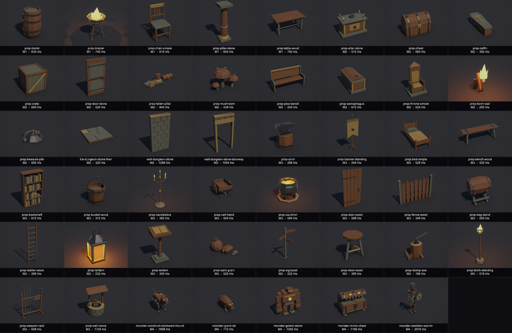
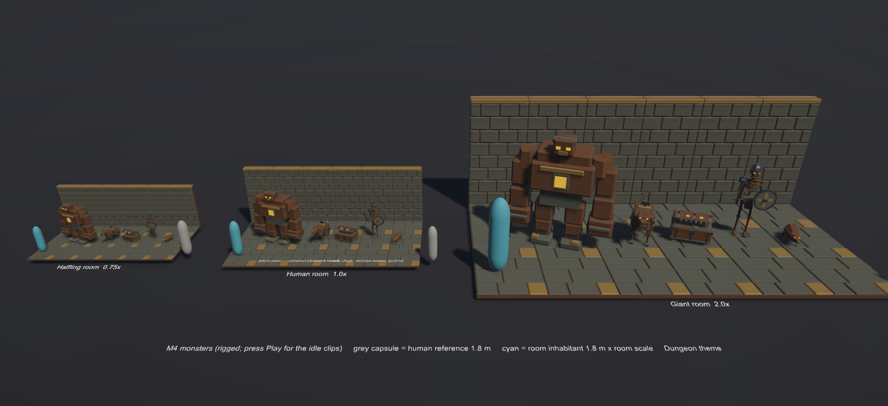
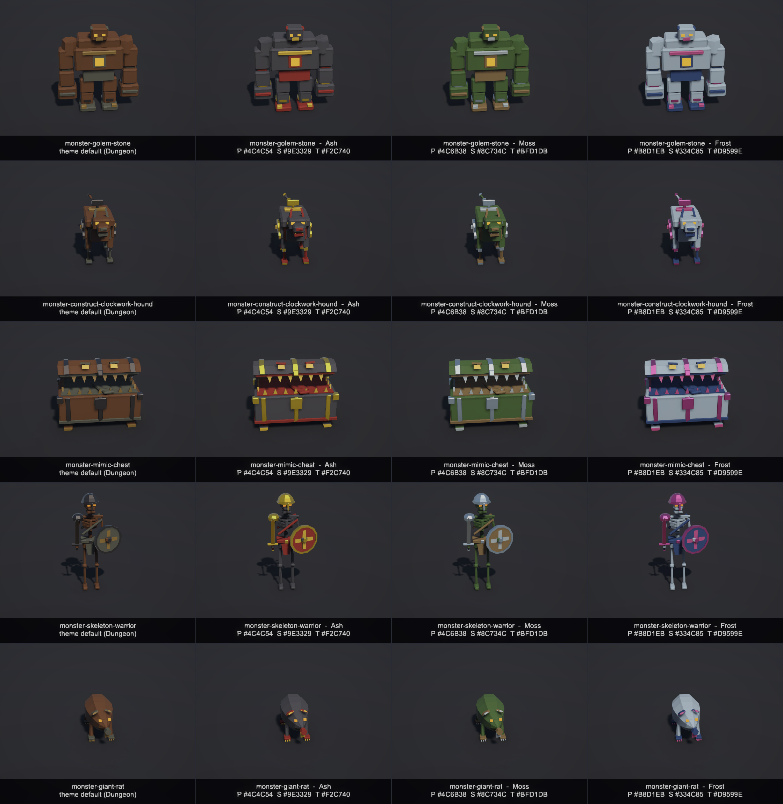
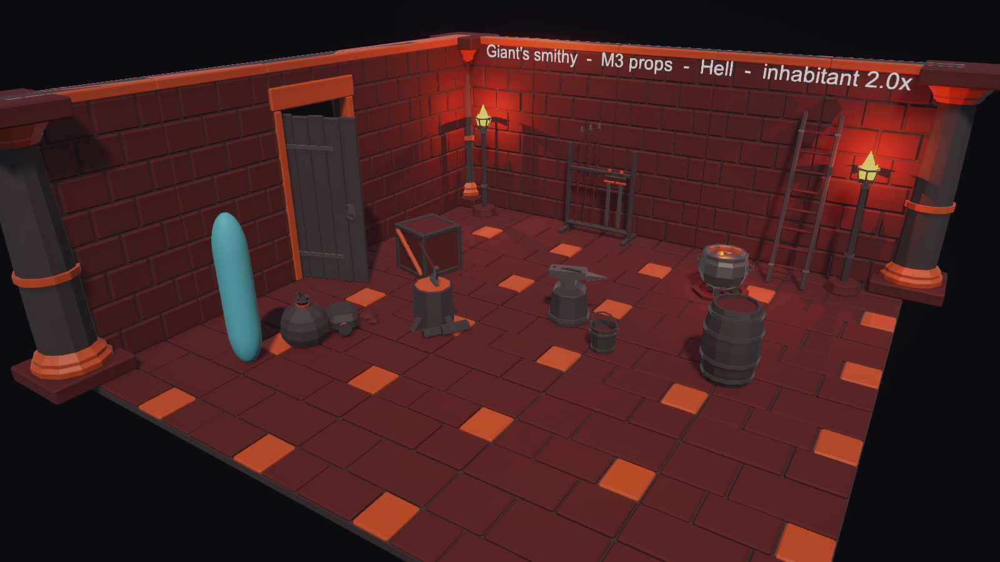

# Open Kit 3D

Free, theme-adaptive, low-poly 3D assets for Unity: the 3D companion to [Open Kit](https://github.com/GrokCodeReliant/OpenKit) (2D).
47 assets (42 props, tiles and walls, plus 5 rigged and animated monsters) that scale to halfling, human, or giant rooms and re-theme at runtime.

**License: CC0 1.0 Universal (public domain). No credit required, commercial use allowed, free forever.** See `LICENSE`.

Everything is procedural (Blender Python) and owned by us. No AI mesh tools, no paid assets.

**Download:** [latest release](https://github.com/GrokCodeReliant/OpenKit3D/releases/latest): `OpenKit3D-M4.unitypackage` (import into a Unity 6 URP project), plus `OpenKit3D-M4-glb.zip` (the 47 GLB files for other engines).









## Requirements to rebuild from source
- Unity **6000.4.0f1** (Unity 6.4) with URP 17.4 (this repo is the Unity project root).
- Blender **5.2.1**.
- `build.ps1` finds the tools via `OKIT_BLENDER` and `OKIT_UNITY` (full paths to `blender.exe` and `Unity.exe`). Without them it uses `blender` on `PATH` and the default Unity Hub folder.
- Generated folders (`Blender/out`, `Builds`, `captures`, `Screenshots`, `Library`, `Logs`) are not in the repo; a build recreates them.

Plan: `PLAN.md`. Build log: `TIMELOG.md`.

## Layout (Unity project lives in the project root, next to `Blender/`)
```
OpenKit3D\
  build.ps1                     one-shot rebuild (Blender + validation, then Unity batchmode); -Clean = from scratch
  Blender\scripts\okit\         bpy helper lib (Builder: box/cylinder/lathe/ring/strut, slot materials, export, previews)
  Blender\scripts\assets\       one script per asset (47: 5 M1, 15 M2, 22 M3, 5 M4), e.g. prop-chair-simple.py, prop-anvil.py
  Blender\scripts\build_asset.py  CLI: --asset <name> | --all  [--preview]
  Blender\params\*.json         per-asset dimensions (edit, rebuild)
  Blender\out\fbx  out\glb  out\previews  out\manifest.json  out\manifest_unity.json
  Assets\OpenKit3D\
    Models\Props\*.fbx   (copied from Blender\out\fbx by the Unity build)   Models\{Tiles,Walls,Monsters} (empty, M2/M3)
    Prefabs\Props\*.prefab   Materials\Slots\{Primary,Secondary,Accent,Metal,Emissive}.mat
    Themes\{Dungeon,Heaven,Hell}.asset   Scripts\Runtime  Scripts\Editor   Scenes\Demo\
  Builds\OpenKit3D-M1/M2/M3.unitypackage   (Builds\ is git-ignored)
  Screenshots\demo-*.png, lineup-themes.png, modular-*.png, catalog-<theme>.png, flame-<theme>.png
  captures\m3\                  M3 contact sheets, combined M1+M2+M3 catalog sheet, hero shots, roomscale.png, colorslots.png (written by RenderScreenshots / CaptureM3)
  Blender\roomadapt_exceptions.json   room-adapt exceptions (asset, rule, reason); read by both validators; currently empty
```
Unity: **6000.4.0f1 (Unity 6.4)**, URP 17.4 (project created from the built-in "Universal 3D" template).
Blender: 5.2.1.

## Rebuild
```
$env:OKIT_BLENDER = "<path to blender.exe>"; $env:OKIT_UNITY = "<path to Unity.exe>"   # optional, see Requirements
powershell -ExecutionPolicy Bypass -File .\build.ps1            # Blender + Unity (All)
powershell -ExecutionPolicy Bypass -File .\build.ps1 -Clean     # from scratch: deletes Blender\out, generated Models/Prefabs/Themes/Materials/Scenes\Demo, captures\m3, captures\m4
powershell -ExecutionPolicy Bypass -File .\build.ps1 -SkipBlender -Method Validate    # Unity-side checks only (also CaptureM3, CaptureM4, CaptureM4Compare, ImportAll, RenderScreenshots)
blender --background --python Blender\scripts\build_asset.py -- --asset prop-barrel --preview
Unity.exe -batchmode -quit -projectPath . -executeMethod OpenKit.Editor.Build.ImportAll          # import, prefabs, themes, demo scenes, .unitypackage
Unity.exe -batchmode -quit -projectPath . -executeMethod OpenKit.Editor.Build.RenderScreenshots  # PNGs from scene cameras
Unity.exe -batchmode -quit -projectPath . -executeMethod OpenKit.Editor.Build.All
```
Also in the editor menu: **Open Kit 3D → Build: …**

## Conventions
- 1 unit = 1 m, pivot bottom-centre, 1.5 m grid. Assets are authored at human scale (1.0).
- Authoring front = Blender −Y. FBX export spins the mesh 180° about Z and uses Apply Transform (`bake_space_transform`) with −Z forward / Y up / FBX_SCALE_ALL,
  so in Unity the root has **rotation 0, scale 1** and the front faces **+Z** (the build logs an orientation check on the chair). GLB is exported unrotated (glTF front = +Z already).
- Flat shading, no textures, ≤5 material slots named Primary / Secondary / Accent / Metal / Emissive (neutral grey in Blender).
- Budgets: small props ≤800 tris, large/environment ≤2,500 (checked by `build_asset.py`, which also checks the pivot).
- `OpenKitModelPostprocessor` enforces import settings under `Assets/OpenKit3D/Models/` (scale 1, Bake Axis Conversion, no cams/lights/anim except the M4 monsters (Generic rig + looping clips), imported normals, slot material remap).

## Runtime system
- `ThemeProfile` (ScriptableObject): palette per slot (colour/metallic/smoothness), emissive intensity, per-slot material overrides, `inhabitantScale`, light tint.
  The build bakes one persistent material per theme × slot as sub-assets of the profile, so saved scenes keep real references.
- `ThemeRoom` (on the room root): holds the profile, a `roomSize` (FromTheme / Halfling 0.75 / Human 1.0 / Giant 2.0, so size no longer has to follow the theme)
  and tints optional room lights. `ThemeRoom.GridCell` = 1.5 m × room scale.
- `ThemeAdaptive` (`[ExecuteAlways]`, on every prefab): maps renderer slots → `ThemeMaterialCache` shared materials;
  `localScale = baseScale × room scale` (every asset, see the room-adapt rule below); applies the 3 user colour slots and the per-prop emissive cap as per-submesh
  MaterialPropertyBlocks (only on instances that use them); tints and scales emissive lights (range and intensity × room scale × `emissiveScale`).
- Themes: Dungeon (halfling 0.75), Heaven (human 1.0), Hell (giant 2.0).

## Demo scenes
- `Scenes/Demo/OpenKit3D-Demo.unity`: the same table, chairs, barrels, brazier, and pillars in a halfling den, a human hall, and a giant's cave. The cyan capsule is a 1.8 m × scale inhabitant reference (scene-only).
- `Scenes/Demo/OpenKit3D-Lineup.unity`: all props in the three themes, side by side.
- `Scenes/Demo/OpenKit3D-M4Monsters.unity` (M4): the 5 monsters in a halfling / human / giant room with the human reference; press Play to see the idle clips (set the Animator bool `walk` for the walk).

## M2 additions
- **Assets (20 total)**: plus prop-crate, prop-chest, prop-torch-wall, prop-altar-stone, prop-fallen-pillar, prop-throne-simple,
  prop-pew-bench, prop-coffin, prop-sarcophagus, prop-door-stone, prop-mushroom, prop-treasure-pile, and the modular
  `tile-dungeon-stone-floor`, `wall-dungeon-stone`, `wall-dungeon-stone-doorway` (the doorway is an extra piece, needed so the door has an opening).
- **Brazier flame reworked**: a fat teardrop body plus 3 curling tongues and 3 licks (`Builder.flame`, rounded profiles, twisted), all Emissive. 740 tris.
- **Pivot modes** (checked by `build_asset.py`): `bottom_center` (default, auto-recentred), `hinge` (prop-door-stone: hinge axis at x=0, leaf toward +X in Blender, which is **−X in Unity**),
  `wall_back` (prop-torch-wall: back plate at y=0, sticks out toward the front, which is +Z in Unity), and `floor_top` (tiles: walking surface at 0, tile body below it).
- ~~**Structural (never scale)**: prop-pillar-stone, prop-fallen-pillar, prop-door-stone, tiles, and walls.~~ Superseded by the room-adapt rule: structural pieces now scale with the room and snap to its grid.
- **Modular grid**: a tile fills one 1.5 m cell. Walls are 1.5 m long, 3.0 m tall (2 cells), and 0.3 m thick, centred on cell edges; stack them in 3 m tiers.
  Blocks use Secondary, the mortar core and joint bed use Primary (so joints contrast in every theme), and cap and trim stones use Accent.
- **Budgets**: ≤800 tris for furniture and small props; ≤2,500 for environment and structural pieces (pillars, fallen pillar, altar, sarcophagus, door, tiles, walls).
- **Themes (6)**: Dungeon 0.75, Heaven 1.0, Hell 2.0, and the new **Crypt 1.0** (human-built tombs, human-size dead), **Jungle 0.75** (small folk: goblins, kobolds, grippli, faerie),
  **Undead 2.0** (bone-giant ossuary). I kept every scale inside the approved set {0.75, 1.0, 2.0}, so no new values need approval.
  Emissive intensities were lowered (1.4–2.2) so flame colours survive tonemapping instead of blowing out to white.
- **Scenes**: `OpenKit3D-Modular.unity` has three rooms built only from tile, wall, and doorway pieces plus the door (Crypt 5×5, Jungle 4×4, and Undead 7×7 with walls stacked 2 high; since the room-adapt pass: 5×5 cells each on the scaled room grid, single-tier walls).
  `OpenKit3D-Catalog.unity` shows all 20 assets; the screenshot step re-themes it for each of the 6 themes and also renders a brazier close-up per theme.
- **Package**: `Builds/OpenKit3D-M2.unitypackage`.

## M3 additions (prop batch 2)
PLAN.md's first 22-item batch was fully built in M1/M2 except its four monsters (items 19-22), and PLAN.md's M3 milestone is those monsters.
This M3 was run as a **prop batch**: 22 new classic-fantasy props that complete the set without duplicating it. The rigid-part monsters and the skinned rat test (old M3) are still open and move to the next milestone.

| Prop | Tris / budget | Class | Notes |
|---|---|---|---|
| prop-anvil | 288 / 800 | Small | horn toward +X in Blender, banded wooden block, hammer |
| prop-banner-standing | 264 / 800 | Small | tripod, swallow-tail cloth (Accent), metal boss |
| prop-bed-simple | 528 / 800 | Medium | head at the back (−Z in Unity) |
| prop-bench-wood | 420 / 800 | Small | backless tavern bench (pew-bench is the church version) |
| prop-bookshelf | 672 / 800 | Medium | 4 shelves of books in Accent/Secondary/Metal |
| prop-bucket-wood | 372 / 800 | Tiny | open, water surface, bail handle |
| prop-candelabra | 382 / 800 | Small | light socket, 3 Emissive flames |
| prop-cart-hand | 564 / 800 | Medium | 2 spoked wheels, handles toward the front |
| prop-cauldron | 472 / 800 | Small | Emissive brew + light socket |
| prop-door-wood | 588 / 2,500 | Medium | structural, **hinge** pivot, fits wall-dungeon-stone-doorway like prop-door-stone |
| prop-fence-wood | 348 / 2,500 | Medium | structural, one 1.5 m section along X, chains on cell edges |
| prop-keg-stand | 560 / 800 | Small | keg on X cradles, brass tap |
| prop-ladder-wood | 296 / 800 | Small | 2.4 m, authored upright (tilt it against a wall in the scene) |
| prop-lantern | 232 / 800 | Tiny | whole glass core is Emissive, light socket |
| prop-lectern | 300 / 800 | Small | slanted desk with open book |
| prop-sack-grain | 412 / 800 | Small | standing + lying sack, spilled grain |
| prop-signpost | 222 / 800 | Small | 3 arrow boards |
| prop-stool-wood | 380 / 800 | Tiny | three-legged |
| prop-stump-axe | 168 / 800 | Small | chopping stump, axe, split logs |
| prop-torch-standing | 518 / 800 | Small | floor torch, iron cage, big light like the brazier |
| prop-weapon-rack | 648 / 800 | Medium | 3 spears, 2 swords |
| prop-well-stone | 1,704 / 2,500 | Medium | environment budget, gabled roof, winch and bucket |

- Same pipeline and style as M2: `okit.Builder` primitives, house bevel, flat shading, colour only from the 5 slot materials (no textures, no vertex colours), 1 unit = 1 m,
  bottom-centre pivot (door = hinge), front = Blender −Y (Unity +Z). Each M3 script sets `MILESTONE = "M3"`, which goes into the manifest (M1/M2 are inferred).
- Light sockets are now shifted along with the bottom-centre recentre, so asymmetric light props keep their light on the flame.
- ~~Structural (never scale): prop-fence-wood and prop-door-wood join the pillars, door, tiles and walls.~~ Superseded by the room-adapt rule (below). The fence is marked static.
- **Validation** (both sides fail the build):
  - Blender (`okit.validate_extra`): naming (`<prefix>-lower-kebab`), prefix↔category (`prop→Props`, `tile→Tiles`, `wall→Walls`, `monster→Monsters`; unknown categories fail), sizeClass, budget tier,
    identity object transform, size-class footprint and height limits, 1..5 house slot materials (no empty, unused or unknown slots, no faces pointing past the list), flat shading, zero-area faces,
    and a new **light-emitting props** check (socket inside the bounds, Emissive slot present). This sits on top of the existing budget and pivot checks. The build exits non-zero on any failure.
  - Unity (`Build.ValidateAssets`, runs inside ImportAll, also `-Method Validate`): name and category, root transform identity, Unity tris = Blender tris ≤ budget, submesh/material count,
    no null or non-slot materials, size = Blender dims (unit-scale check), pivot per mode in Unity axes, prefab present with BoxCollider and ThemeAdaptive (`scalesWithRoom` matches),
    light iff socket, and no orphan or misfiled FBX/prefabs in any category folder.
- **Scenes**: `OpenKit3D-M3Hero.unity` has an inn (Dungeon 0.75), a giant's smithy (Hell 2.0; since the room-adapt pass 5×5 giant cells with 6 m walls and a giant doorway) and a village yard fenced with prop-fence-wood (Heaven 1.0).
  `OpenKit3D-Catalog.unity` now lays out all 42 assets in 7 columns.
- **Captures** (`captures\m3\`): `m3-contact-sheet-dungeon.png`, `m3-contact-sheet-heaven.png` (22 labelled tiles, name + tris), `catalog-m1-m2-m3.png` (42 tiles, name + milestone + tris),
  `hero-{dungeon,hell,heaven}.png`, `hero-{dungeon,hell,heaven}close.png`, `hero-overview.png`.
- **Package**: `Builds/OpenKit3D-M3.unitypackage` (all 42 assets, scripts, themes, scenes).
- **License**: all Open Kit 3D assets are released under CC0 1.0 (public domain: no credit required, commercial use allowed) and are free forever. See `LICENSE`.

## M4 additions (monsters)

Five monsters, category Monsters, milestone M4. All have `SCALES_WITH_ROOM` True and pass room-adapt with 0 exceptions.
Each one exposes Primary / Secondary / Tertiary (Accent + Metal) user slots, plus Emissive eyes/core (`EMISSIVE_SCALE` 0.6-0.7).

| Asset | Size class | Tris / budget | Bones | Clips | Notes |
|---|---|---|---|---|---|
| monster-golem-stone | Large | 1,592 / 5,000 | 11 | idle (72 f), walk (40 f) | rigid parts |
| monster-construct-clockwork-hound | Medium | 1,808 / 5,000 | 17 | idle (48 f), walk (24 f) | rigid parts; hinged jaw, 3-bone tail, turning wind-up key |
| monster-mimic-chest | Medium | 1,196 / 2,500 | 7 | idle (48 f), walk (24 f) | rigid parts; lid rests 25 deg open, teeth/tongue/eyes, 4 stubby legs |
| monster-skeleton-warrior | Medium | 2,076 / 5,000 | 18 | idle (64 f), walk (32 f) | rigid parts; shield on left forearm, sword in right hand, helmet |
| monster-giant-rat | Small | 712 / 2,500 | 12 | idle (48 f), walk (24 f) | smooth-skinned body + tail (weights blend along the spine/tail), rigid legs/head |

- **Rig pipeline** (Blender, `Blender/scripts/okit`): `with b.bone("name"):` binds the parts built in that block rigidly (weight 1.0). `with b.bone(okit.AUTO):` plus `build(skin=fn)` writes smooth weights.
  Asset scripts declare `RIG` (bones: name/head/tail/parent) and `CLIPS`. A clip is procedural sine channels `(bone, rx|ry|rz|lx|ly|lz, amplitude, whole cycles, phase)` at 24 fps, and the whole-number cycles make the loop seamless.
  Export is an FBX with the armature and all actions (`bake_space_transform` on, so the mesh and rig nodes import at identity; without it the mesh child came in with a 90 deg X rotation) and a GLB with the same rig and clips.
- **Unity**: `OpenKitModelPostprocessor` v4: `Models/Monsters` imports as a Generic rig, avatar from the model, clips renamed `rig|rig|idle` to `idle`, loop on, no compression.
  `BuildPrefabs` gives a rigged prefab an Animator (no root motion) and a controller at `Prefabs/Monsters/<name>.controller` (idle is the default state, walk is the state behind it on the bool parameter `walk`).
  Scene `Scenes/Demo/OpenKit3D-M4Monsters.unity`: 3 rooms (halfling 0.75 / human 1.0 / giant 2.0), the monsters in a row, a grey 1.8 m human reference and a cyan inhabitant capsule, camera `Cam_MonsterLineup`.
  Build entry points: `OpenKit.Editor.Build.CaptureM4` and `OpenKit.Editor.Build.CaptureM4Compare` (tag from the env var `OKIT_CAPTURE_TAG`, default `after`). `build.ps1 -Clean` also clears `captures\m4`.
- **Validators**:
  - Blender `validate_rig`: monsters need a `RIG` and an idle clip; every vertex is weighted and the weights sum to 1; no stray groups; whole-number cycles; at most 40 bones.
  - Unity `ValidateMonster`: exactly one `SkinnedMeshRenderer`, bone count matches Blender, every vertex weighted, manifest clips present, looping and at least 0.2 s, an Animator with idle, and no root curves.
  - The room-adapt render check also runs on the skinned meshes (rat Tertiary changed 55 px, threshold 6; all 47 OK).
- **Fixes** (PLAN M4 follow-ups):
  - **prop-sack-grain** silhouette: the standing sack is a squat, slumped, leaning pear with a gathered neck, tie cord, floppy 4-flap tuft and a Secondary patch; the lying sack is a plump pillow with a tied flared end. 412 to 526 tris.
  - **prop-stump-axe**: the axe head is 40% larger and lifted so only the cutting edge bites ~2.5 cm into the cut face; a dark split sits in the cut face. 168 to 196 tris.
  - **Hell**: Primary obsidian `(0.10,0.08,0.09, smooth 0.7)` to `(0.25,0.20,0.21, smooth 0.22)`; Metal `(0.22,0.18,0.17)` to `(0.48,0.42,0.39)`. Removes the mortar glints near the torches and lifts dark silhouettes.
  - **Giant smithy** hero room: a warm front fill (intensity 7) and an ember rim light (intensity 10), outside `ThemeRoom.roomLights` so they are not re-tinted.
  - **Wall torch** light intensity 1.6 to 1.25.
  - **Heaven**: Secondary sky stone `(0.66,0.76,0.92)` to `(0.46,0.56,0.78)` and Primary marble `(0.93,0.92,0.88, smooth 0.55)` to `(0.88,0.86,0.80, smooth 0.45)` for yard contrast.
- **Captures** (`captures\m4\`): `monster-lineup-roomsizes.png`, `monster-colorslots.png` (rows = monsters; theme default + Ash/Moss/Frost combos), `monster-clips.png` (4 frames per clip),
  `m4-contact-sheet-dungeon.png`, `m4-contact-sheet-undead.png`, `catalog-m1-m4.png` (47 assets), and before-*/after-* pairs: sack-dungeon, sack-heaven, stump-axe, torch-wall-hell, torch-wall-dungeon, smithy, smithy-close, yard, yard-close.
- **Package**: `Builds/OpenKit3D-M4.unitypackage`. Total assets 47 (M1 5, M2 15, M3 22, M4 5).
- **Weak spots**: clips are procedural sine loops (placeholder quality, no foot locking; walk slides if the monster is moved). The rat Tertiary slot is small (inner ears/incisors/claws). Lineup labels are small in the halfling room. The hound and the rat look narrow in the head-on colour-slot view. Skeleton limbs are thin at distance.

## Room-adapt rule (every asset, enforced by both validators)
Every Open Kit 3D asset must **(1) room-scale** (halfling 0.75 / human 1.0 / giant 2.0), **(2) re-theme at runtime**, and **(3) expose 3 working user colour slots**.
The only way out is an entry in `Blender/roomadapt_exceptions.json`: `{"asset": "...", "rule": "room_scale" | "color_slots", "reason": "..."}` (a reason is required).
**The list is empty: all 47 assets comply, with no exceptions.**

- **Room size is independent of the theme**: `ThemeRoom.roomSize` = FromTheme (the profile's `inhabitantScale`, the old behaviour) / Halfling / Human / Giant.
- **Structural pieces scale too.** Pillars, fallen pillar, both doors, fence, floor tile, walls and doorway now scale with the room and **snap to the room grid** (cell = 1.5 m × scale;
  `ROOM_SCALE = "grid"` in the asset script → `ThemeAdaptive.snapsToRoomGrid`). Door and doorway scale together, so the door always fits. A giant room's walls are 6 m tall
  (no more 2-tier stacking) and its doorway is giant-sized (fixes the QA note about the human-sized door in the giant smithy). The scene builders lay rooms out on `1.5 × scale` cells.
- **User colour slots** (`ThemeAdaptive.primaryColor / secondaryColor / tertiaryColor`, each with an enable toggle; `SetUserColor(slot, colour or null)` from code):

  | User slot | Material slots it recolours |
  |---|---|
  | Primary | Primary |
  | Secondary | Secondary |
  | Tertiary | Accent + Metal (trim and hardware) |

  An override sets `_BaseColor` in a per-submesh MaterialPropertyBlock on top of the theme's shared material. Clearing it removes the block and the theme colour returns.
- **Outside the user slots:** the **Emissive** slot (flames, brew, glowing gills, lantern core) and **the prop lights**. Both follow the theme (emissive colour × intensity, lights
  tinted to the emissive colour). They are capped per prop by `EMISSIVE_SCALE` (asset script) → `ThemeAdaptive.emissiveScale`: prop-lantern 0.45 and prop-cauldron 0.4 (fixes the
  cauldron white-out and the lantern glow). Light range scales with the room; light intensity = base × theme factor × room scale × `emissiveScale`.
- **Mesh fixes so every asset has a visible region for each user slot:** brazier (legs → Primary), candelabra (base → Secondary, stem → Primary), chest (lid seam trim → Secondary),
  crate (braces → Accent), lantern (base → Primary, posts → Secondary), sack-grain (grain heaps → Secondary), stool (stretchers → Accent), cauldron (new firewood = Primary,
  hearth ring = Secondary; 584 tris), treasure-pile (new plank = Primary, coin pouch = Secondary; 692 tris), floor tile (slab → Accent), mushroom (the Accent spots were buried in the cap;
  the Unity render check caught it; they now sit on the cap). The well crank also gained an axle and sits on its post (1,724 tris).
- **Blender validator** (`okit.validate_roomadapt`, in every build): scales with the room unless excepted and `ROOM_SCALE` is valid; every material maps to a user slot or Emissive;
  faces exist for all 3 user slots unless excepted; a scale-safe pivot (bottom at z=0, or the top at 0 for floor tiles); grid pieces (tiles, walls) exactly 1.5 m wide; `EMISSIVE_SCALE` in (0, 1].
  The manifest records `roomScale`, `emissiveScale`, `user_slots`, `ok_roomadapt`.
- **Unity validator** (`Build.ValidateRoomAdapt`, inside `ValidateAssets`, so it runs in ImportAll and `-Method Validate`), per prefab under a test `ThemeRoom`:
  for Halfling/Human/Giant, `localScale` = scale, renderer bounds scale by the same factor and light range = base × scale; under two themes every submesh gets that theme's shared material;
  every renderer is in the slot map. For **each user slot**, it checks that at least one submesh maps to it, that the property block is really set, and **renders the prop at 128 px from 3 angles
  with and without the override: at least 6 pixels must change**. Hidden or zero-area regions fail. Clearing the overrides must leave no block behind.
- **Proof tests (removed afterwards):** `prop-zz-roomadapt-failtest` (no room scaling, Primary only) was rejected by the Blender validator for both reasons.
  `prop-zz-hidden-tertiary` (passes Blender, but its only Accent box is sealed inside the body) was rejected by the Unity render check: "Tertiary changes 0 visible pixels".
- **QA fixes (M3 look pass):** giant door and doorway scale with the room; well crank on an axle; cauldron emissive/light cap and a cooler Catalog (sun 0.9 → 0.7, ambient × 0.85);
  Catalog spacing 4.8 × 4.5 m with labels 1.9 m in front (the doors no longer hide the candelabra and hand cart, and labels don't overlap props); hero rooms 18 m apart and each area camera's far plane ends just past its own room, so it shows only that room.
- **Captures:** `captures\m3\roomscale.png` (stool, bench, bed, wooden door in its doorway, lantern and bookshelf in halfling / human / giant rooms of the same Dungeon theme;
  grey capsule = fixed 1.8 m human reference, cyan = 1.8 m × room scale) and `captures\m3\colorslots.png` (prop-bed-simple, 3 colour combos × 3 room sizes, labelled with the hex values).
