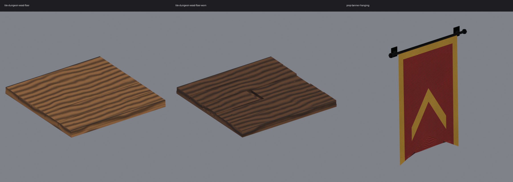

# Open Kit: Medieval Environment, Batch 1

Three low-poly medieval dungeon pieces: two wood floor tiles and a hanging wall banner. Each one is an FBX model with 512 px PNG texture maps.

**License: CC0 1.0 Universal (public domain).** You can use them for anything, including commercial work. No credit required. See `LICENSE`.

## Contents

| Asset | Triangles | Size in metres (X x Y-up x Z) | Material slots | Textures |
|---|---|---|---|---|
| `tile-dungeon-wood-floor` | 192 | 1.5 x 0.10 x 1.5 | Primary | `mat_wood_oak_*` |
| `tile-dungeon-wood-floor-worn` | 204 | 1.5 x 0.10 x 1.5 | Primary | `mat_wood_dark_*` |
| `prop-banner-hanging` | 708 | 1.06 x 1.48 x 0.09 | Primary (cloth), Metal (rod and brackets) | `mat_cloth_banner_*`, `mat_iron_*` |

- `fbx/` has the models. `tex/` has the textures.
- Every texture set has three maps: `_albedo` (sRGB), `_normal` (OpenGL-style, +Y up) and `_ao` (linear).
- Scale: 1 unit = 1 metre.
- Floor tiles fill a 1.5 m grid cell. The pivot is at the centre of the walking surface (y = 0), and the tile body sits below it.
- Banner: the pivot is on the wall plane at the back of the brackets, centred on X, with y = 0 at the lowest tip of the cloth. Mount it with the rod at about 2.3 to 2.6 m.

## What is included (and what is not)

This pack has **FBX models and PNG textures only**. There are no Unity materials, prefabs, scenes or `.meta` files. You need to set up your own materials.

## Using it in Unity (URP)

1. Copy `fbx/` and `tex/` into your `Assets` folder.
2. Make one Lit material per texture set. Put the albedo in Base Map, the normal in Normal Map (set the texture type to Normal map), and the AO in Occlusion.
3. Assign each material to its matching slot on the model.

## Known notes (please check on import)

- **Facing and scale have not been tested in Unity yet.** The models were exported at 1 unit = 1 m with Y up. After import, check that the tiles lie flat, that the banner faces away from the wall, and that the sizes match the table. Adjust Scale Factor or rotation if they don't.
- **The banner cloth is a single-sided sheet.** If the back of the cloth can be seen, use a two-sided material for the Primary slot (in URP Lit, set Render Face to Both, which turns culling off).
- The texture references inside the FBX files are file names only. If your importer does not find the textures, assign them by hand from `tex/`.

## Files

`MANIFEST.json` lists every file in the pack, with per-asset data.
